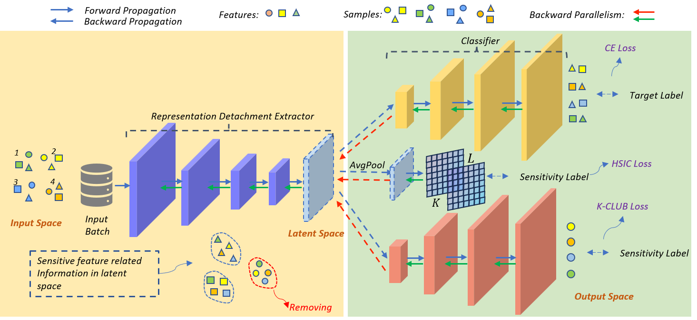

# Neural Model Shaping via Selective Feature Learning



## Introduction

This repository contains the official implementation of the paper **"Neural Model Shaping via Selective Feature Learning"**.

Training machine learning models in real-world domains such as healthcare or finance often necessitates the use of private or sensitive data. However, stringent data protection regulations (e.g., GDPR, HIPAA) mandate rigorous privacy preservation. Existing strategies, such as masking, coarsening, or traditional machine unlearning, often lead to a catastrophic loss of data utility and model performance. 

To strike the optimal balance between privacy-preserving and model performance maintenance, we propose a novel **Selective Feature Learning** framework for neural model shaping. Specifically:

* **Macro-level Decoupling via HSIC**: We employ the Hilbert-Schmidt Independence Criterion (HSIC) to impose a global structural constraint, enforcing statistical independence between the learned representations and sensitive attributes across the dataset.
* **Micro-level Conditional Decoupling via K-CLUB**: We introduce a novel Kernel-Guided Contrastive Log-ratio Upper Bound (K-CLUB). This micro-level filter utilizes task-conditional masking to eliminate fine-grained sensitive features while preserving the specific semantic information required for the primary task, significantly stabilizing gradient variance.
* **Efficient Parallel Optimization**: We optimize the framework using a two-timescale Stochastic Alternating Gradient Descent-Ascent (SGDA) and introduce a local parallelism acceleration strategy to overcome the backward locking problem, ensuring high efficiency and a low memory footprint.

Extensive empirical experiments on various benchmarks (Fairface, CelebA, CIFAR-10) validate that our framework successfully achieves the optimal Pareto frontier. It comprehensively neutralizes targeted sensitive attributes while approaching the utility levels of traditional unprotected learning.

## How to Run

### 1. Installation

Please follow the commands below to create a Conda environment and install the necessary dependencies:

```bash
# Create and activate the environment
conda create -n unlearning python=3.8
conda activate unlearning

# Install dependencies
pip install -r requirements.txt
```

### 2. Usage

We provide scripts for both quick verification and batch reproduction of the experiments mentioned in the paper.

#### Verification (Single Run)
You can run the `chap.py` script to perform a single-run verification. Within `chap.py`, you can easily configure parameters such as the dataset, target predicting attribute, protected sensitive attribute, and backbone models.

```bash
cd PSI/public
python chap.py
```

#### Batch Reproduction
To reproduce the full ablation studies and comparative results (e.g., the K-CLUB decoupling evaluation), navigate to the scripts directory and execute the batch files:

```bash
cd PSI/scripts
bash k_club.sh
```
*Note: We also provide other batch script files in the `scripts` directory corresponding to different experimental settings and baseline comparisons.*